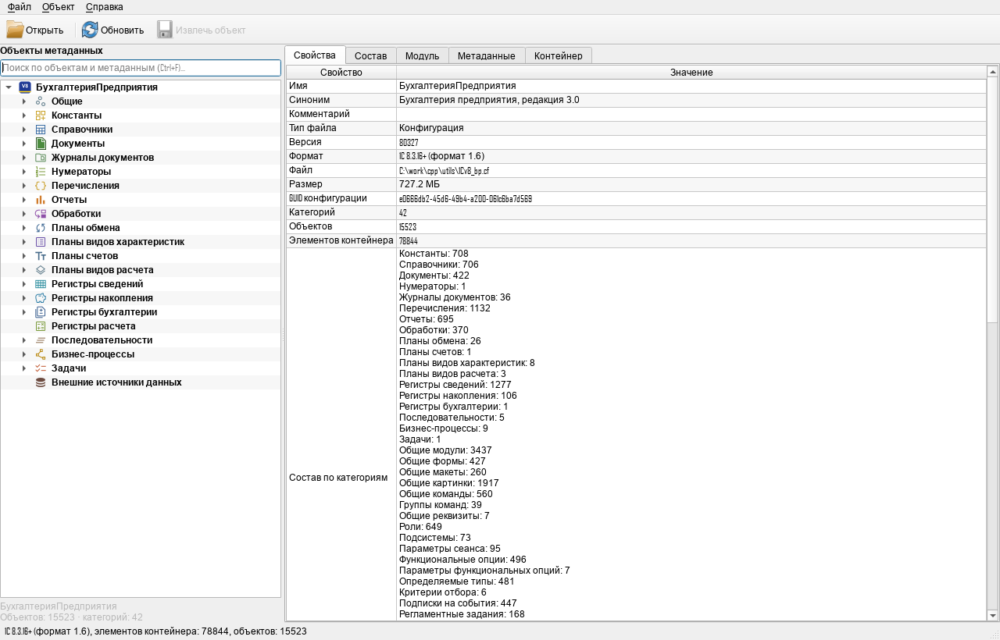
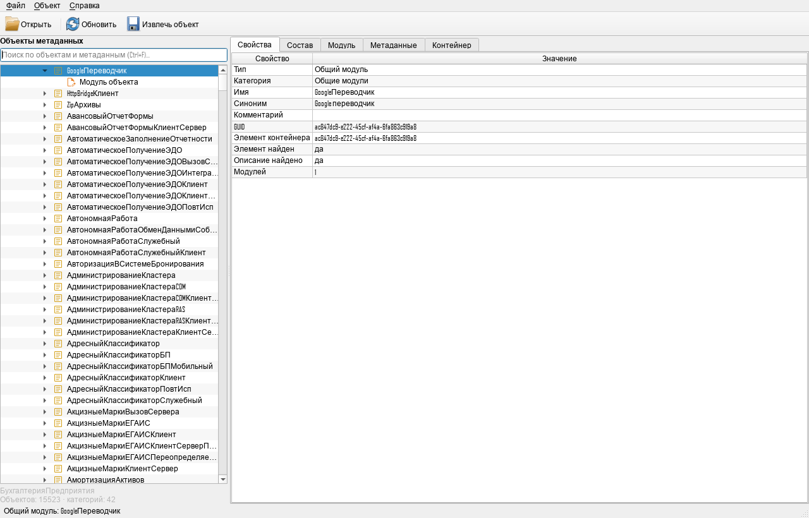

# qtv8reader

[](https://github.com/fishca/qtv8reader/actions/workflows/build.yml)

Чтение конфигураций и внешних обработок 1С:Предприятие 8 на C++17 и Qt6.

Проект повторяет назначение [fishca/v8_reader](https://github.com/fishca/v8_reader):
показывает дерево метаданных конфигурации, состав объектов, тексты модулей и умеет
выгружать объекты на диск. Отличие — кроссплатформенный стек (CMake + Qt6 + zlib)
и наличие консольного интерфейса для пакетной обработки.

## Возможности

- Контейнеры 1С:V8 форматов **1.5** (1С 8.0–8.3.15) и **1.6** (1С 8.3.16+),
  включая сжатые блоки (raw deflate) и файлы `.cfu` (контейнер, сжатый целиком).
- Виды файлов:
  - `.cf` — конфигурация;
  - `.cfe` — расширение конфигурации (читается через элемент `configinfo`);
  - `.epf` / `.erf` — внешняя обработка / внешний отчёт;
- Дерево метаданных в стиле 1С: конфигурация → стандартные ветки (Общие,
  Константы, Справочники, Документы, Журналы документов, Перечисления, Отчёты,
  Обработки, Планы …, Регистры …, Бизнес-процессы, Задачи, Внешние источники)
  → объекты → модули и разделы состава (реквизиты, табличные части с реквизитами,
  формы, команды, макеты, измерения, ресурсы и т. д.). При открытии файла дерево
  свёрнуто и выглядит как в конфигураторе 1С; состав объекта подгружается лениво
  при раскрытии узла.
- Иконки типов объектов и разделов в стиле 1С (открытый набор metadata-icons,
  MIT), поиск по дереву (Ctrl+F), отображение свойств выбранного узла,
  модуля и текста метаданных.
- Состав объекта по таблицам 1С: реквизиты, измерения, ресурсы, табличные части
  (с реквизитами), формы, команды, макеты, значения перечислений, признаки учёта.
- Тексты модулей: модуль объекта, модуль менеджера и модули форм
  (включая вложенные контейнеры `text`/`module`).
- Выгрузка объекта или всей конфигурации в каталог: `metadata.txt`,
  `composition.txt`, `info.txt`, модули `.bsl`, формы, макеты и двоичные данные.
- GUI (Qt Widgets): дерево, свойства, состав, модули, метаданные, дерево элементов
  контейнера, предпросмотр и сохранение элементов, недавние файлы, drag & drop.
- CLI: `info`, `list`, `tree`, `dump`, `metadata`, `modules`, `composition`,
  `extract`, `extract-all`.
- Разбор больших конфигураций распараллелен (Qt Concurrent); состав объектов
  разбирается лениво — по мере выбора объекта.



Вид по умолчанию — стандартные ветки конфигурации, как в 1С.



Раскрытый объект: модули, макеты, табличные части и реквизиты.

## Готовые сборки

Самодостаточные сборки публикуются в разделе
[Releases](https://github.com/fishca/qtv8reader/releases):

- **Windows 10/11 x64** — `qtv8reader-<версия>-windows-x86_64.zip`:
  Qt и все библиотеки внутри, установка не нужна. Распаковать и запустить
  `qtv8reader.exe`.
- **Linux x64** — `qtv8reader-<версия>-linux-x86_64.AppImage`: один
  самодостаточный файл, Qt и зависимости внутри. Требуется glibc 2.35+
  (Ubuntu 22.04+, Debian 12+, Fedora 36+):

  ```sh
  chmod +x qtv8reader-*.AppImage
  ./qtv8reader-*.AppImage
  ```

- **Linux x64** — `qtv8reader-<версия>-linux-x86_64.tar.gz`: те же бинарники
  с библиотеками, включая консольную утилиту `bin/v8reader_cli`.

Релиз собирается автоматически при отправке тега:

```sh
git tag v0.3.0
git push origin v0.2.0
```

## Требования

- CMake ≥ 3.22;
- компилятор с поддержкой C++17 (проверено на GCC 16 из MSYS2/MinGW-w64, MSVC 2022);
- Qt 6.4+ с модулями `Core`, `Gui`, `Widgets`, `Test`, `Concurrent`;
- zlib;
- Boost **не требуется**.

## Сборка

### Windows, MSYS2 (MinGW-w64 + Ninja)

```bat
set MSYS2_ROOT=C:\work\cpp\msys64
cmake -S . -B build -G Ninja -DCMAKE_TOOLCHAIN_FILE=cmake/mingw64-toolchain.cmake
cmake --build build
```

В готовом каталоге `build` появятся:

- `qtv8reader.exe` — графическое приложение;
- `v8reader_cli.exe` — консольная утилита;
- `qtv8reader_tests.exe` — тесты.

Для запуска исполняемых файлов вне MSYS2-окружения добавьте в `PATH` каталог
`<MSYS2>\mingw64\bin` (там лежат DLL Qt и zlib).

### Linux (Ubuntu/Debian, Qt 6 из репозитория)

```sh
sudo apt-get install -y build-essential cmake ninja-build \
    qt6-base-dev qt6-base-dev-tools libgl1-mesa-dev zlib1g-dev
cmake -S . -B build -G Ninja -DCMAKE_BUILD_TYPE=Release
cmake --build build
ctest --test-dir build --output-on-failure
```

### Универсальный вариант

```sh
cmake -S . -B build -DCMAKE_BUILD_TYPE=Release
cmake --build build
ctest --test-dir build --output-on-failure
```

Сборки под Windows (MSYS2/MinGW) и Linux (GCC) автоматически выполняются в
GitHub Actions; workflow — [.github/workflows/build.yml](.github/workflows/build.yml).

## Использование

### Графическое приложение

```bat
qtv8reader.exe path\to\config.cf
```

Поддерживается drag & drop файла в окно. Для проверки без показа окна (например,
в CI) есть режим самопроверки:

```bat
set QT_QPA_PLATFORM=offscreen
qtv8reader.exe path\to\config.cf --smoke
```

### Консольная утилита

```text
v8reader_cli <команда> <файл> [объект] [-o каталог] [--raw]

  info <файл>                  сведения о файле и составе категорий
  list <файл>                  список категорий и объектов метаданных
  tree <файл>                  элементы контейнера с размерами и датами
  dump <файл> <элемент>        данные элемента (текст или hex), -o для сохранения
  metadata <файл> <объект>     текст метаданных объекта
  modules <файл> <объект>      тексты модулей объекта (объект, менеджер, формы)
  composition <файл> <объект>  состав объекта: реквизиты, ТЧ, формы, макеты
  extract <файл> <объект> -o <каталог>   сохранить объект на диск
  extract-all <файл> -o <каталог>        сохранить все объекты

Объект задаётся GUID, именем или синонимом; для dump — именем элемента контейнера.
```

Примеры:

```bat
v8reader_cli info "C:\1c\bp.cf"
v8reader_cli composition "C:\1c\bp.cf" АвансовыйОтчет
v8reader_cli extract "C:\1c\bp.cf" 225d7842-f8f4-4d0e-9173-7b0c9608e4af -o out
v8reader_cli modules work.epf Обработка -o modules.txt
```

## Архитектура

```
src/
  core/
    V8Container.*          контейнер 1C:V8: заголовки, TOC, блочные цепочки, zlib
    V8Text.*               разбор формата текста 1С (списки, строки, #base64)
    MetadataCatalog.*      категории метаданных, раскладка таблиц состава, GUID
    Configuration.*        модель: конфигурация → категории → объекты → состав
    ConfigurationReader.*  сборка модели из контейнера, поиск описателей объектов
    ModuleExtractor.*      поиск текстов модулей в элементах контейнера
    Extractor.*            выгрузка объектов на диск
  gui/                     Qt Widgets приложение
  cli/                     консольная утилита
tests/                     Qt Test: контейнер, текст, метаданные
```

Ключевые решения:

1. **Контейнер** разбирается целиком в память; поддерживаются варианты заголовка
   1.5/1.6 (`baseOffset`, разные размеры записей FAT и заголовков блоков).
   Полезная нагрузка элемента при необходимости распаковывается raw deflate
   (с запасным вариантом zlib).
2. **Текст 1С** разбирается в дерево узлов (список/строка/значение) с поддержкой
   двойных кавычек, локализованных строк и `#base64:`/`#data:`.
3. **Категории** объектов находятся по таблицам вида
   `{<GUID категории>, <количество>, <GUID объекта>...}` в корне конфигурации.
4. **Описатель объекта** (`{вид, {1, 0, GUID}, "Имя", {локализация}, "Комментарий"}`)
   ищется рекурсивно с привязкой к ожидаемому GUID; поддерживаются варианты
   формата 1.5 (`{0, 0, GUID}`) и вида `2`/`3`.
5. **Состав объекта** читается по позициям таблиц, зафиксированным в 1С для
   каждого типа (справочники, документы, регистры, планы и т. д.); для форм и
   макетов имя берётся из описателя соответствующего элемента контейнера.
   Дополнительно выполняется поиск таблиц по известным GUID — это страхует
   отличия версий формата.
6. **Расширения** (`.cfe`) определяются по наличию элемента `configinfo`:
   это поток из нескольких значений, где хранится GUID корневого объекта.
7. **Внешние обработки/отчёты** (`.epf`/`.erf`) — «конфигурация из одного
   объекта»: корневой объект обёрнут в `{1, {GUID}, 1, {ClassId, тело}}`,
   а состав читается по GUID таблиц (порядок таблиц у них другой).
8. **Модули**: кандидаты `<GUID>.<N>` проверяются в порядке эталонного
   v8_reader (объект: `.0…5`, менеджер: `.3, .1, .2, .4, .5, .0`); внутри
   вложенного контейнера ищутся элементы `text`/`module`. Тексты-справки HTML
   и описания отбрасываются по эвристике.

## Тесты

```bat
ctest --test-dir build --output-on-failure
```

Покрыто: синтетические контейнеры форматов 1.5/1.6 (в том числе сжатые,
с цепочками блоков и вложенными контейнерами), разбор текста и GUID,
построение модели конфигурации, состав объекта, модули, выгрузка, расширения,
внешние обработки, имена объектов формата 1.5, ленивый разбор состава.
Тесты с реальными файлами (`1Cv8_test1.cf`) пропускаются, если файлов нет.

## Ограничения

- Проект работает **только на чтение**.
- «Хранилище конфигурации» в виде 1CD-базы (таблицы `DEPOT`, `VERSIONS` и т. п.)
  не поддерживается; читаются только файловые контейнеры `.cf/.cfe/.epf/.erf/.cfu`.
- Для экзотических версий платформы возможны расхождения в составе объектов;
  для них предусмотрен резервный поиск таблиц по GUID.
- Тип внешнего файла (`.epf`/`.erf`) определяется по расширению; содержимое
  внешней обработки и внешнего отчёта устроено одинаково.
- Тексты модулей, у которых нет явных признаков кода (например, модуль из
  одной строки-оператора), могут не распознаваться.

## Исследовательские материалы

- [docs/research/metadata-sections.md](docs/research/metadata-sections.md) —
  разбор путей и таблиц состава по исходникам эталонного v8_reader.
- [docs/research/containers.md](docs/research/containers.md) — форматы
  `.cf/.cfe/.epf/.erf`, `configinfo`, хранилище конфигурации.

## Лицензии сторонних компонентов

Готовые сборки включают библиотеки Qt 6 (LGPL-3.0), zlib, ICU и другие
компоненты с открытыми лицензиями; их перечень и условия —
[packaging/THIRD-PARTY-NOTICES.txt](packaging/THIRD-PARTY-NOTICES.txt).
Библиотеки Qt поставляются отдельными файлами, поэтому их можно заменить
совместимыми сборками.

## Лицензия проекта

Проект создан как учебный/прикладной ридер; код эталонного v8_reader
использовался только как источник знаний о формате 1С.
