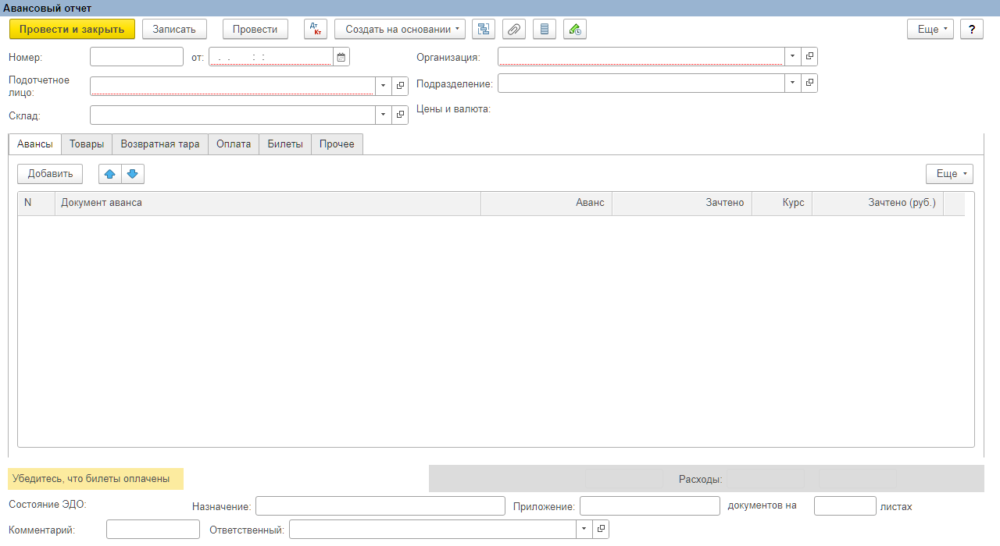

# qtv8reader v0.11.0

**24 ноября 2026**

0.11.0 — это цикл «форма как в конфигураторе», где сверка пошла не по
свойствам, а по картинке: форма документа «Авансовый отчёт» снимается
в HTML-рендерере тем же размером полотна, что и в конфигураторе, и
сравнивается с эталоном попиксельно. Первое, что она показала, — весь текст
формы рисовался на 8 % мельче: шрифт был 12 px вместо 13. Вместе со шрифтом
пришлось пересчитать то, что под него подгонялось: колонку подписей и высоту
их строк. Дальше по замеру закрылись маска пустого поля даты, полоса вкладок,
рамка страницы, выравнивание заголовков числовых колонок и ширины полей,
а таблица без заданной высоты стала занимать остаток страницы. Для самой
сверки в репозитории появился инструмент `tools/form_view_measure.py`.

## Главное

- **Шрифт формы — 13 px, как у платформы.** По линейке глифов эталон сходится
  только с 13 px: «Авансы» занимают 45 px, «Документ аванса» — 102,
  «Номер:» — 40. На 12 px те же слова выходили 40–42, 93–95 и 39–40 px.
  Вместе со шрифтом пересчитаны колонка подписей и высота строки подписи:
  ячейка 99 px плюс 5 px до поля дают те же 104, что в конфигураторе, а поля
  начинаются на 115 (эталон — 114). Подпись в две строки больше не уводит
  вниз весь ряд.
- **Пустое поле даты рисуется с маской** — точки-разделители даты и двоеточия
  времени на тех же местах, что в конфигураторе: метки по 2×1 px на 12, 24,
  56 и 68 px от внутреннего края, нижняя — на 7 px выше нижней рамки.
- **У полей появились глифы кнопок.** Кнопки выбора, открытия и очистки
  рисовались пустыми рамками: рендерер ссылается на фигуры из спрайта,
  а спрайта в ресурсах не было. Теперь он есть, и пиксельные глифы «▾»
  и «Открыть» совпадают с конфигуратором попиксельно.
- **Ширины полей и колонок — по правилам конфигуратора.** Ширина «Номера»
  документа, «Кода» и «Наименования» справочника берётся из стандартных
  реквизитов объекта, ширина поля ссылки — из длины представления
  и ограничивается 40 знаками, непоместившиеся колонки шапки распределяются
  по остатку полотна. «Номер» стал 120 px вместо 160, поле «Подотчетное лицо»
  встало на 115…480 против эталонных 114…481.
- **Таблица без заданной в форме высоты забирает остаток страницы**
  и доходит до низа полотна, как в конфигураторе. Раньше страница считалась
  по содержимому: таблица получала 125 px и заканчивалась на 364, а под ней
  из-под низа выглядывали группы подвала.
- **Полоса вкладок и рамка страницы.** Полоса закрыта снизу линией,
  невыбранная вкладка залита #ebebeb, страница обведена по бокам — как
  в конфигураторе. Полоса заголовка стала 21 px вместо 23 и получила цвета
  неактивного окна платформы (153, 180, 209), поэтому всё содержимое формы
  перестало уезжать вниз на 2 px.
- **Заголовки числовых колонок прижимаются вправо** по
  `HeaderHorizontalAlign = Right` — «Аванс» стоит на 446…481 при линии
  колонки 491. Свойство раньше не разбиралось, и все заголовки рисовались
  слева.
- **Инструмент сверки вида.** `tools/form_view_measure.py` собирает модель
  формы командой `v8reader_cli form-model`, снимает её в HTML-рендерере
  при заданном размере полотна, печатает границы рамок полей и разделителей
  колонок сразу для снимка и эталона и склеивает их в одну картинку.
  Замеры и разбор оставшихся расхождений — в `docs/form-exact-view.md`.



## Точный вид формы

### Шрифт и колонка подписей

- Шрифт формы — 13 px. Проверено по ширине глифов эталона: «Авансы» 45 px,
  «Документ аванса» 102, «Номер:» 40; у 13 px по чернилам выходит 44,6–45,7,
  101,9–103,4 и 43,2–43,6, у 12 px — 40,4–42,2, 93–95,5 и 39,5–40,3.
- Колонка подписей складывается из ячейки подписи и просвета до поля.
  `THROUGH_ALIGN_LANE_CHROME` уменьшен с 7 до 1: семёрка компенсировала
  недомер шрифта, теперь 99 + 5 = 104, как в конфигураторе, и поля начинаются
  на 115 при эталонных 114.
- Высота строки подписи считается по размеру шрифта (`REF_LABEL_LINE_HEIGHTS`:
  13 → 16 px), а не наследуемым `line-height: 1.3`. Двухстрочная подпись
  «Подотчетное лицо:» была на 1 px выше эталона и уводила вниз весь ряд
  полей — теперь ряд стоит на месте.

### Пустое поле даты

- Маска — часть редактора даты, а не подсказка оформления: платформа рисует
  её в любом пустом поле даты и даты-времени. Рендерер ставит метки
  в `appendDateMask`: точки-разделители даты и двоеточия времени по 2×1 px
  на 12, 24, 56 и 68 px от внутреннего края поля, нижняя — на 7 px выше
  нижней рамки.
- Сверено с эталоном: там те же места (279, 291, 323, 335 при левой рамке
  266) и та же плотность чернил.
- Ширина поля даты считается по «знаки * 10 + 10»: для даты-времени 15 знаков
  дают 160 px, и поле встало на 267…426 против эталонных 266…426, кнопка
  календаря — на 447 в обоих. Раньше рендерер считал 17 знаков и поле было
  180 px.

### Ширины полей

- «Номер» документа, «Код» и «Наименование» справочника: длина номера —
  12-е поле списка свойств записи, кода — 17-е, наименования — 19-е. Просмотрщик
  читает их из метаданных объекта (`applyOwnerStandardAttributes`) и передаёт
  рендереру в `objectMeta`. Сверено с выгрузкой в XML: семь документов (длины
  0, 9, 11, 12, 13) и семь справочников (коды 3…11, наименования 10…150).
- Поле ссылки: ширина берётся из длины представления объекта, на который
  ссылается реквизит, и ограничивается 40 знаками. У «Физических лиц» 100,
  у «Организаций» 150, у «Складов» 50 — все дают 409 px. Метаданные
  справочников приходят узлом `refMeta` (`applyReferencedCatalogMeta`),
  ширину считает `presentationLengthOf`; без метаданных остаётся платформенный
  минимум 15 знаков.
- Колонки шапки распределяются так же, как в платформе: ведущие получают
  предпочтительную ширину, последняя — остаток полотна
  (`fitRootHeaderColumnRemainder`). Было: обе получали измеренную (уже сжатую)
  ширину, шапка занимала 925 px из 958, вторая колонка начиналась на 42 px
  левее. Стало: «Подотчетное лицо» 115…480 против 114…481, «Организация»
  637…924 против 637…927, граница колонок 533.
- Правило проверяют тесты `TestForm::ownerStandardAttributes`
  и `TestForm::ownerMetadataAndTableColumns`.

### Колонки таблицы

- Заданная в форме ширина колонки без редактора действует как есть: «N»
  с `Width = 3` — 47 px. Раньше рендерер отводил такой колонке 20 знаков
  и полосы кнопок.
- Номер строки с заданной шириной не получает отступ ведущей колонки.
- Реквизит, которого нет в метаданных, даёт 15 знаков без полос кнопок
  («Аванс», «Зачтено (руб.)» — 168 px), такая же колонка без заголовка
  сжимается до одного знака («Отступ» — 28 px), составной тип даёт 24 знака
  («Документ аванса» — 253 px).
- Разделители колонок совпали с эталоном: 323, 491, 670, 747, 915. Сумма
  колонок укладывается в сетку, горизонтальная прокрутка пропала и таблица
  перестала обрываться.

### Таблица и страница

- Таблица без заданной в форме высоты забирает остаток страницы и доходит
  до низа полотна; группы подвала уходят за кадр, в полотне прокрутки формы
  они остаются доступны. Раньше `fitRootPagesPreferredHeights` пропускал
  страницы с таблицей намеренно — теперь только таблицы с заданной высотой
  и табличные документы.
- Панель страницы больше не обведена рамкой: в конфигураторе линии стоят
  только на краях таблицы и формы. Отступ панели (10 px) оставлен — именно он
  ставит таблицу на 21…958, как в эталоне.

### Вкладки, заголовок и рамка

- Полоса вкладок закрыта снизу линией на всю ширину страницы, невыбранные
  вкладки залиты #ebebeb, страница обведена по бокам линиями на x = 10
  и на правом краю полотна. Раньше полоса обрывалась без границы, а рамки
  страницы не было вовсе.
- Полоса заголовка — 21 px и цвета неактивного окна (153, 180, 209): было
  23 px, и всё содержимое формы уезжало вниз на 2 px.

### Шапка таблицы

- Заголовок колонки прижимается вправо, если у колонки
  `HeaderHorizontalAlign = Right`: «Аванс» стоит на 446…481 при линии колонки
  491. Свойство не разбиралось, и все заголовки рисовались слева.

### Глифы кнопок полей

- Рендерер рисует кнопки выбора, открытия и очистки как `<svg><use href="#i-…">`,
  а формы-спрайта с этими фигурами в ресурсах проекта не было: кнопки «▾»,
  «Открыть», «…» и крестик очистки оставались пустыми рамками.
- `resources/formpreview/icons.svg` (из BslEdit, MIT) кладётся в qrc,
  а `model-app.js` загружает спрайт до первой отрисовки.
- Пиксельные глифы `i-px-caret-down` и `i-px-open-1c` совпали с конфигуратором
  попиксельно: у «Подотчетного лица» оба глифа совпадают по тёмным пикселям
  (33 из 33), рамки стоят на 480…521 против 481…522.

### Снимок формы

- `model-app.js` ставит признак готовности только после того, как
  раскодировались все ``, — иначе кнопки перемещения строки и «Дт/Кт»
  попадали в снимок пустыми.
- Модель для WebView2 получает `runtime`-поля (`defaultChars`, кнопки выбора,
  пределы ширины) при загрузке: их выводит
  `FormPreview.applyTypeDefaultsToModel`. Без этого вызова сериализованная
  модель отдавала только авторские свойства, и любое поле получало ширину
  в 20 символов и теряло кнопки выбора.
- Дата документа получает вид значения `DateTime` из метаданных, поэтому
  поле считается по тому же правилу, что и в конфигураторе.

## Инструмент сверки вида

- `tools/form_view_measure.py`:

  ```sh
  python tools/form_view_measure.py sync --root out/preview
  python tools/form_view_measure.py serve --root out/preview --port 8765
  python tools/form_view_measure.py render --out out/ours.png
  python tools/form_view_measure.py marks --image out/ours.png --rows 67,248
  python tools/form_view_measure.py pair --ours out/ours.png --out out/pair.png
  ```

  `render` собирает модель через `v8reader_cli form-model` и снимает страницу
  в headless-Chrome при заданном размере полотна, `marks` печатает
  непрерывные участки серого по строке — рамки полей и разделители колонок —
  сразу для снимка и эталона, `pair` склеивает эталон и снимок в одну картинку,
  `serve` поднимает локальный сервер без кеша, `sync` раскладывает
  `resources/formpreview` в каталог раздачи. `render` вызывает `sync` сам:
  иначе снимок идёт по копии ресурсов от прошлой правки, и исправление в CSS
  или в скрипте не видно.
- `--object`, `--form`, `--cf` и `--width/--height` переопределяют объект,
  форму, контейнер и размер полотна. Картинка в `README.md` и в описаниях
  релизов — снимок панели формы при 1280×700.
- Замеры и разбор причин расхождений — в `docs/form-exact-view.md`,
  раздел «Замеренные расхождения».
- Сверка заодно показывает, что модель не теряет свойства: расхождение
  в геометрии почти всегда означает потерянное свойство элемента, а не ошибку
  вёрстки.

## Что осталось

- По снимку 988×438 из 432 744 пикселей расходятся 26 838 (6,2 %). Остались
  известные смещения:
  - содержимое ниже вкладок стоит на 2–5 px ниже эталона: оболочка `.fp-item`
    (`padding: 1px 0` и прозрачная рамка) добавляет группе 2 px снизу, а
    платформа заканчивает группу по рамке поля. Снять оболочку целиком нельзя —
    под неё подогнаны высоты рядов: без неё расходятся уже 32 628 пикселей;
  - страница на 2–3 px уже эталона (правый край 966–967 против 969), поэтому
    рамка таблицы 22…955 вместо 21…958 и последняя колонка берёт меньше;
  - первый разделитель колонки «N» — 70 вместо 68;
  - своя полоса прокрутки формы (узкая дорожка с кнопками-стрелками справа)
    не рисуется, прокрутку даёт браузер.
- `ShowWarning` (предупреждение о незаполненном поле) не рисуется: в выгрузке
  БП его нет ни у одной из 7890 форм, оформление не проверено.
- По корпусу формы всё ещё не отдают часть свойств: обработчики событий
  (`Events`), пути к данным полей панели настроек отчёта (`DataPath`,
  `FooterDataPath`), параметры и список выбора (`ChoiceParameters`,
  `ChoiceParameterLinks`, `ChoiceList`), `WindowOpeningMode`, `AutoTime`,
  `Width` самой формы, `AutoCommandBar` и дополнения поиска у таблицы,
  подпись, картинку и представление общих команд на панели.
- У двух форм «Авансового отчёта» — «ВыданныеАвансы» и «Суточные» — модель
  отдаёт только командную панель: таблица, поля и итоги не разбираются.
- Полный список разобранных свойств и правил — в
  [docs/form-exact-view.md](docs/form-exact-view.md).

## Проверено

- Снимок формы «Авансового отчёта» при 988×438 против эталона конфигуратора:
  расходятся 26 838 пикселей из 432 744 (6,2 %, порог 24 на канал).
- Границы, снятые `marks`: разделители колонок таблицы 323, 491, 670, 747,
  915 совпадают с эталоном попиксельно; поля шапки начинаются на 115 против
  114.
- Шрифт сверен по трём словам эталона («Авансы», «Документ аванса»,
  «Номер:»), маска даты — по четырём меткам эталона, глифы кнопок — по тёмным
  пикселям (33 из 33).
- 121 автотест: 100 ядра, 10 CLI, 11 GUI. `ctest` — 3/3. Сборка
  MSYS2/MinGW-w64 (GCC 16, Qt 6.11.2, Release).

## Ограничения

- Проект работает только на чтение; исполнение модулей и форм
  не поддерживается. Просматриваются управляемые формы (8.2/8.3/BAS);
  обычные формы 8.1/8.2 не поддерживаются.
- Вид близок к конфигуратору, но не бит-в-бит: оставшиеся расхождения
  перечислены в [docs/form-exact-view.md](docs/form-exact-view.md).
- Точный вид доступен только в Windows-сборке: на Linux и без WebView2
  остаётся упрощённый рендерер.

## Готовые сборки

### Windows 10/11 x64

`qtv8reader-v0.11.0-windows-x86_64.zip` — портативная сборка, Qt и все
библиотеки внутри, установка не требуется. Распаковать и запустить
`qtv8reader.exe`. Для точного вида нужен WebView2 Runtime.

### Linux x64

- `qtv8reader-v0.11.0-linux-x86_64.AppImage` — самодостаточный файл
  (glibc 2.35+):

  ```sh
  chmod +x qtv8reader-v0.11.0-linux-x86_64.AppImage
  ./qtv8reader-v0.11.0-linux-x86_64.AppImage
  ```

- `qtv8reader-v0.11.0-linux-x86_64.tar.gz` — бинарники с библиотеками,
  включая `bin/v8reader_cli`.

Контрольные суммы — в `SHA256SUMS`.

## Лицензии сторонних компонентов

Сборки включают Qt 6 (LGPL-3.0), zlib, ICU и другие библиотеки с открытыми
лицензиями; SDK WebView2 и рендерер BslEdit — с условиями Microsoft (MIT для
BslEdit). Полный перечень — в `THIRD-PARTY-NOTICES.txt` в составе пакета.
Библиотеки Qt поставляются отдельными файлами и могут быть заменены
совместимыми сборками.

Проект: https://github.com/fishca/qtv8reader
